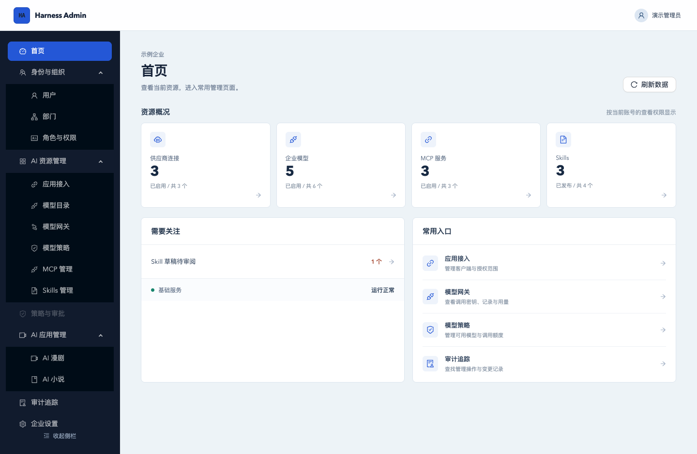
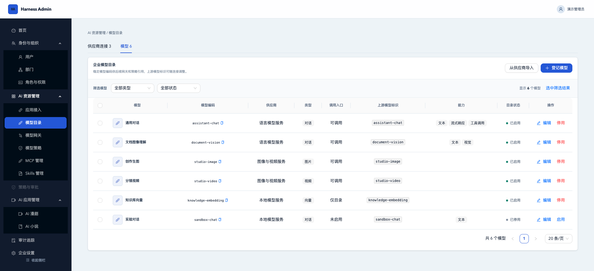

# Harness Admin

Harness Admin 是一个可自托管的企业 AI 管理后台。你可以在同一处接入模型、MCP 服务和企业 Skills，为员工及应用分配使用权限，并查看调用记录和用量。

[快速启动](#快速启动) · [界面预览](#界面预览) · [开发与部署](docs/development.md) · [API 契约](api/openapi.yaml)

## 主要功能

| 功能 | 可以做什么 |
| --- | --- |
| 企业与账号 | 管理企业、部门、员工和角色权限，查看审计记录。通过 OIDC 让桌面端和服务端应用使用企业账号登录。 |
| 模型目录与网关 | 接入模型供应商，以统一入口调用聊天、图片和视频模型。按员工、部门或调用密钥控制可用模型和额度，查看用量、预警及调用记录。 |
| MCP 管理 | 接入远程 MCP 服务，发现和测试工具，为员工或开发者分配连接。也可在隔离的 Docker 环境中托管受信任的 Node.js、Python Stdio 服务。 |
| 企业 Skills | 从本地压缩包或公开 GitHub 仓库导入 Skill，审阅文件、发布版本，并按部门或员工授权。 |
| AI 创作 | 在漫剧工作台管理剧本、角色和场景资产，拆分分镜并生成片段视频。在小说工作台规划大纲、逐章写作和审稿。 |

## 界面预览

以下截图使用演示数据。



<details>
<summary>查看模型目录</summary>



</details>

## 快速启动

安装并启动 Docker Desktop，或准备 Docker Engine 和支持 `up --wait` 的 Docker Compose。拉取代码后，在项目根目录执行：

```bash
make demo-up
```

也可以直接运行 `docker compose -f compose.demo.yaml up --build --wait`。首次启动会下载镜像和依赖，构建前后端，并自动初始化数据库和账号。

| 登录入口 | 企业 | 用户名 | 初始密码 |
| --- | --- | --- | --- |
| [企业管理端](http://127.0.0.1:18080/) | 演示企业 | `admin` | `demo-admin` |
| [平台管理端](http://127.0.0.1:18080/platform/login) | — | `platform-admin` | `demo-platform` |

启动完成后可以直接登录。模型调用和 AI 创作功能需要在「AI 资源管理 → 模型目录」配置上游模型。若端口已被占用，可以设置 `HARNESS_DEMO_PORT` 后重新启动。

运行 `make demo-down`（或 `docker compose -f compose.demo.yaml down`）停止服务并保留数据。

默认账号和密码仅用于本机演示。日常开发和正式部署的配置见[开发与部署指南](docs/development.md)。

## 文档

- [开发与部署](docs/development.md) · 代码结构、数据库迁移、接入配置和验证命令
- [OpenAPI 契约](api/openapi.yaml) · 接口、认证与数据结构
- [图片与视频模型网关](docs/model-media-gateway.md) · 媒体生成与任务查询
- [MCP 接入方案](docs/enterprise-skills-mcp-plan.md) · 服务来源、网关和权限
- [企业 Skills 接入](docs/enterprise-skill-management-plan.md) · 导入、发布与分发
- [漫剧工作流](docs/ai-drama-workflow.md) · 剧本解析、资产与分镜制作

## 开源许可证

本项目采用 [MIT 许可证](LICENSE)。
