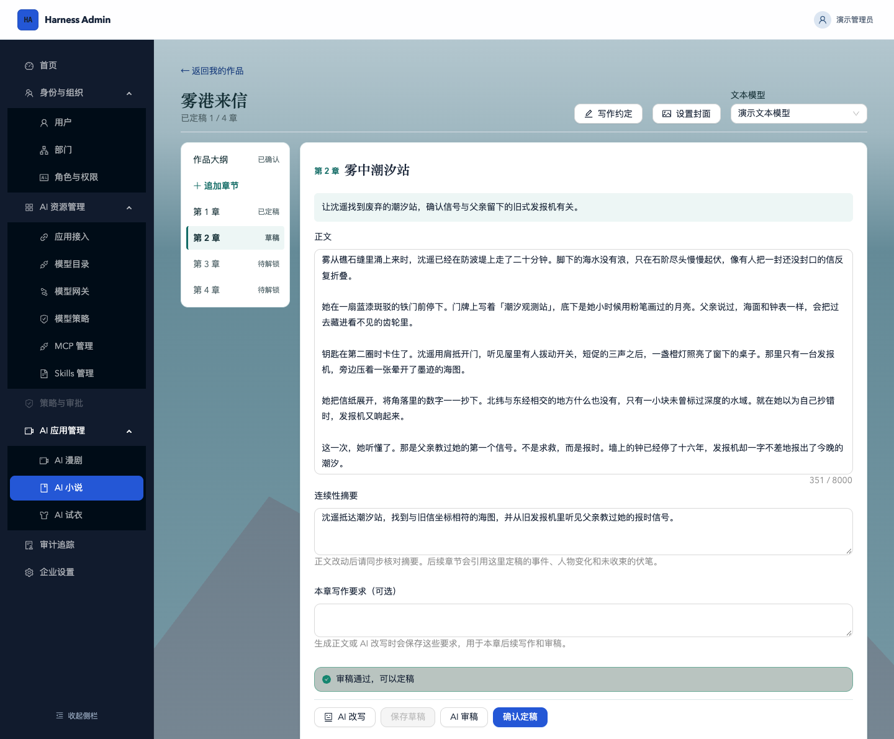
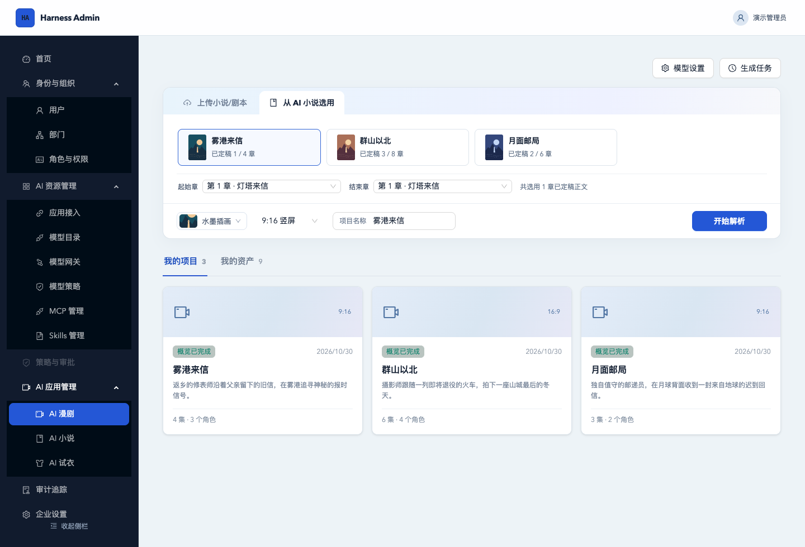
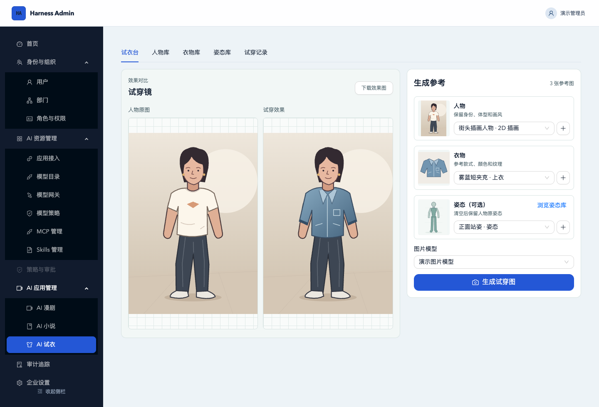

# Harness Admin

Harness Admin 是一个可自托管的企业 AI 管理平台，也是一个 Go 管理后台脚手架。你可以基于它开发自己的后台，搭配企业插件为 DeepSeek Harness 接入公司账号和 AI 资源，也可以直接在网页里写小说、做漫剧和生成试穿效果图。

[快速启动](#快速启动) · [Go 项目脚手架](#go-项目脚手架) · [DeepSeek Harness 企业接入](#deepseek-harness-企业接入) · [AI 创作工作台](#ai-创作工作台) · [界面预览](#界面预览)

## Go 项目脚手架

如果你要做一个带账号、权限和管理界面的 Go 项目，可以从这个仓库起步。它自带平台与企业两级管理入口，提供企业隔离、员工与部门管理、角色权限、会话管理、审计记录和 OIDC 应用接入。

后端采用 Go 模块化单体，使用 Gin、PostgreSQL 和 Redis，提供数据库迁移、健康检查和 OpenAPI 契约。管理端使用 React、TypeScript 和 Ant Design，已有登录、导航和权限控制。扩展自己的业务时，可以沿用现有模块结构，在 `internal/` 增加后端能力，在 `web/src/` 增加管理页面。[开发与部署指南](docs/development.md) · [OpenAPI 契约](api/openapi.yaml)

## DeepSeek Harness 企业接入

要在 DeepSeek Harness 中使用企业账号和 AI 资源，需要安装独立插件 `dsh-enterprise-bundle`。管理员在 Harness Admin 配置账号和资源权限，员工在 DeepSeek Harness 登录后，可以使用获授权的模型、MCP 工具和企业 Skills。[插件源码与安装指南](https://github.com/aDreamyWind/dsh-enterprise-bundle)

| 企业资源 | 管理员可以配置什么 |
| --- | --- |
| 企业登录 | 登记 Web 或桌面客户端，通过 OIDC 配置回调地址和授权范围。 |
| 模型目录与网关 | 接入供应商并维护模型目录，为员工、部门或调用密钥配置模型范围和额度，查看用量、预警和调用记录。网关也提供聊天、图片和视频调用接口。 |
| MCP 服务 | 登记远程服务、发现和测试工具，再为员工或开发者分配连接。也可在隔离的 Docker 环境中托管受信任的 Node.js 或 Python Stdio 服务。 |
| 企业 Skills | 从压缩包或公开 GitHub 仓库导入 Skill，审阅文件、发布版本，并按部门或员工授权。 |

1. **配置 Harness Admin。** 在「AI 资源管理 → 模型目录」启用至少一个对话模型，记录模型编码。再到「应用接入」登记客户端。Desktop 选「桌面应用」，回调填 `http://127.0.0.1/oauth/callback`。Web 选「服务端应用」，回调填 Web Host 的完整回调地址。插件默认申请 `openid`、`profile`、`model.invoke`、`mcp.invoke` 和 `offline_access`。如需员工 MCP 工具，再把相应连接授权给员工或部门。[OIDC 应用接入说明](docs/development.md#oidc-应用接入)

2. **从 npm 安装插件。** 以下命令使用插件 `0.2.2`，适配 DeepSeek Harness `0.2.2-alpha.2`。[npm 安装包](https://www.npmjs.com/package/dsh-enterprise-bundle) · [宿主版本兼容记录](https://github.com/aDreamyWind/dsh-enterprise-bundle/blob/main/compatibility.json)

   **Desktop** 先启动桌面应用一次以初始化 profile，退出后使用安装包附带的 `dsh`：

   ```bash
   dsh plugin --profile desktop add dsh-enterprise-bundle@0.2.2
   ```

   **Web** 在已构建的兼容 Harness 源码目录执行。第一条命令仅用于首次创建 `enterprise-web` profile：

   ```bash
   pnpm dsh --profile enterprise-web --from-default-profile web --dump-config
   pnpm dsh plugin --profile enterprise-web add dsh-enterprise-bundle@0.2.2
   ```

3. **连接到 Harness Admin。** Desktop 将安装包里的 `desktop.patch.example.yml` 合入桌面 profile 的 `cordis.patch.yml`，Web 则在启动 Harness Web 的工作目录按安装包里的 `.env.example` 配置，客户端密钥保存在 Web Host。两端都要填写 OIDC 签发者、客户端 ID、网关地址和模型编码。配置完成后启动 Harness，用企业账号登录并选择获授权的模型。本机使用 `make demo-up` 时，默认签发者是 `http://127.0.0.1:18080`，网关是 `http://127.0.0.1:18080/v1`。[桌面端配置](https://github.com/aDreamyWind/dsh-enterprise-bundle#desktop) · [Web 配置](https://github.com/aDreamyWind/dsh-enterprise-bundle#web)

需要单独下载配置示例或安装包时，可运行 `npm pack dsh-enterprise-bundle@0.2.2` 获取 `.tgz`。用本地文件安装时，将 `dsh plugin add` 命令中的包名和版本换成该文件的绝对路径。也可以按插件仓库的说明自行构建。[源码构建说明](https://github.com/aDreamyWind/dsh-enterprise-bundle#从源码构建)

## AI 创作工作台

三套工作台都在管理端的「AI 应用管理」下，使用模型目录中已启用并授权的上游模型。

| 工作台 | 可以完成的工作 |
| --- | --- |
| AI 小说 | 从故事灵感开始规划大纲和章节，逐章写稿、审稿和定稿，并为作品上传或生成封面。 |
| AI 漫剧 | 从创意或原文创建项目，解析剧本和分集，管理角色、场景和道具，编辑分镜并生成片段视频。 |
| AI 试衣 | 上传或生成插画及写实人物，从照片识别并裁剪衣物，再搭配人物、衣物和可选姿势生成试穿图，并排比较效果或查看历史。 |

小说和漫剧可以串起来使用。小说章节定稿后，可以直接选取连续章节创建漫剧项目，接着做分集、资产和分镜。[漫剧工作流](docs/ai-drama-workflow.md) · [AI 试衣说明](docs/ai-tryon-design.md)

## 界面预览

以下截图使用演示数据。

### 企业首页


### 模型目录


### AI 小说 · 章节写作与审稿



### AI 漫剧 · 选章改编与项目管理



### AI 试衣 · 参考素材与效果对比



## 快速启动

安装并启动 Docker Desktop，或准备 Docker Engine 和支持 `up --wait` 的 Docker Compose。拉取代码后，在项目根目录执行：

```bash
make demo-up
```

也可以直接运行 `docker compose -f compose.demo.yaml up --build --wait`。首次启动会下载镜像和依赖，构建前后端，并自动初始化数据库和账号。

如果 npm 下载超时，可以设置 `HARNESS_DEMO_NPM_REGISTRY` 为你信任的 npm 镜像地址，再运行同一条启动命令。

| 登录入口 | 企业 | 用户名 | 初始密码 |
| --- | --- | --- | --- |
| [企业管理端](http://127.0.0.1:18080/) | 演示企业 | `admin` | `demo-admin` |
| [平台管理端](http://127.0.0.1:18080/platform/login) | — | `platform-admin` | `demo-platform` |

启动完成后可以直接登录。模型调用和 AI 创作功能需要在「AI 资源管理 → 模型目录」配置上游模型。若端口已被占用，可以设置 `HARNESS_DEMO_PORT` 后重新启动。

运行 `make demo-down`（或 `docker compose -f compose.demo.yaml down`）停止服务并保留数据。

默认账号和密码仅用于本机演示。日常开发和正式部署的配置见[开发与部署指南](docs/development.md)。

## 文档

- [开发与部署](docs/development.md) · 代码结构、数据库迁移、接入配置和验证命令
- [OpenAPI 契约](api/openapi.yaml) · 接口、认证与数据结构
- [图片与视频模型网关](docs/model-media-gateway.md) · 媒体生成与任务查询
- [MCP 接入方案](docs/enterprise-skills-mcp-plan.md) · 服务来源、网关和权限
- [企业 Skills 接入](docs/enterprise-skill-management-plan.md) · 导入、发布与分发
- [漫剧工作流](docs/ai-drama-workflow.md) · 剧本解析、资产与分镜制作

## 开源许可证

本项目采用 [MIT 许可证](LICENSE)。
